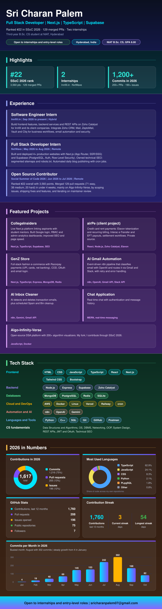

Text version of this profile

**Sri Charan Palem**: Full Stack Developer (Next.js, TypeScript, Supabase). Third-year B.Sc. CS student at NIAT, Hyderabad. Ranked #22 in Social Summer of Code 2026 with 3,560 points and 129 merged pull requests.

**Experience**
- Software Engineer Intern, Innfill.in (Sep 2026 to present): frontend, backend and REST APIs on Zoho Catalyst; integrations with Zoho CRM, Mail, ZeptoMail, Vault and Cliq.
- Full Stack Developer Intern, NxtWave (May to Aug 2026): 4+ production websites with Next.js and Supabase; technical SEO (segmented sitemaps, robots.txt); cron-based daily blog publishing.
- Open Source Contributor, SSoC 2026 (Jun to Jul 2026): 129 merged PRs, mainly on Algo-Infinity-Verse.

**Projects**: CollegeInsiders (Next.js, TypeScript, Supabase), airPe (client project: Elavon payments, Interac e-Transfer, EFT), GenZ Store, AI Gmail Automation, AI Inbox Cleaner, Chat Application, Algo-Infinity-Verse.

**Skills**: JavaScript, TypeScript, Python, C++, SQL, React, Next.js, Tailwind CSS, Node.js, Express, Supabase, Zoho Catalyst, MongoDB, PostgreSQL, Redis, AWS, Docker, Linux, n8n, OpenAI, Git.

