
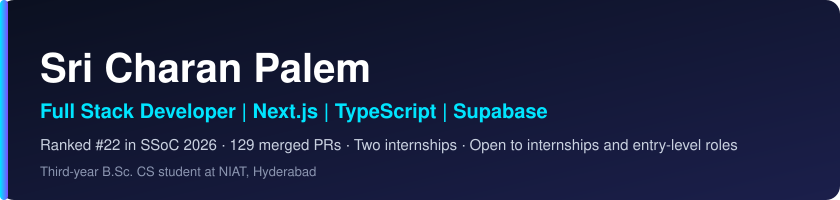

---

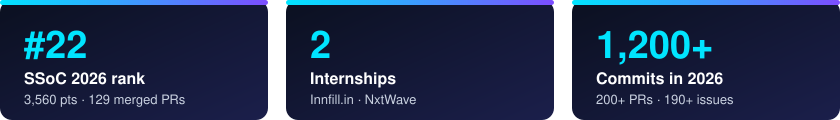

---

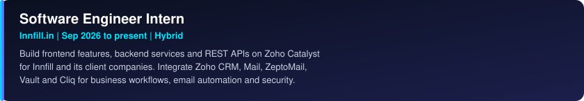

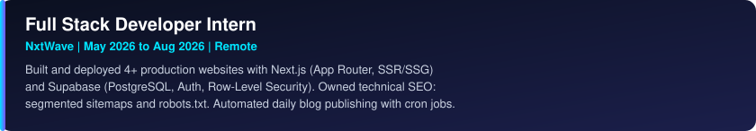

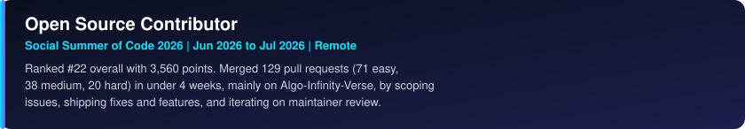

---

<table align="center">
  <tr><td><a href="https://collegeinsiders.in">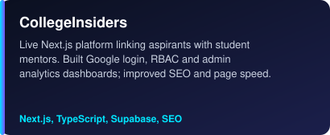</a></td><td>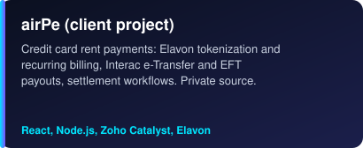</td></tr>
  <tr><td><a href="https://github.com/sricharan12-hub/genzstore">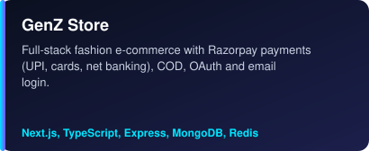</a></td><td><a href="https://github.com/sricharan12-hub/Gmail-Automation">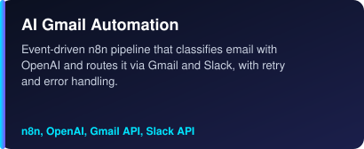</a></td></tr>
  <tr><td><a href="https://github.com/sricharan12-hub/n8n-project">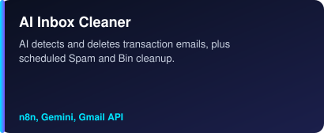</a></td><td><a href="https://github.com/sricharan12-hub/Chat-application">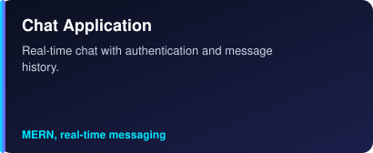</a></td></tr>
  <tr><td><a href="https://github.com/sricharan12-hub/Algo-Infinity-Verse">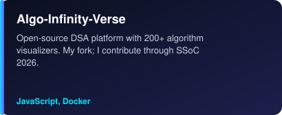</a></td></tr>
</table>

---

      

   

   

    

  

    

**CS fundamentals:** Data Structures and Algorithms, Operating Systems, DBMS, Networking, OOP, System Design, REST APIs, JWT and OAuth, Technical SEO

---

<table align="center">
  <tr>
    <td align="center" valign="top" width="420">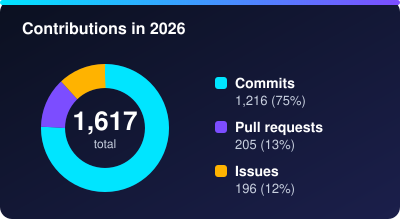</td>
    <td align="center" valign="top" width="420">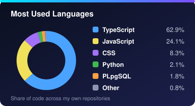</td>
  </tr>
  <tr>
    <td align="center" valign="top" width="420">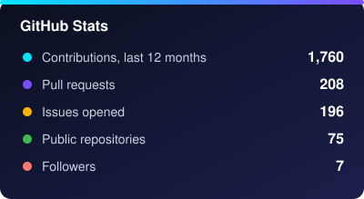</td>
    <td align="center" valign="top" width="420">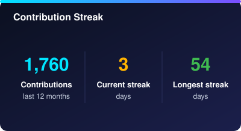</td>
  </tr>
</table>

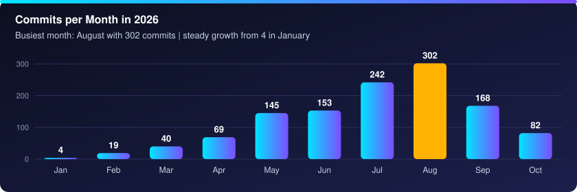

---

**Open to internships and entry-level roles.** Reach me at [sricharanpalem07@gmail.com](mailto:sricharanpalem07@gmail.com).
