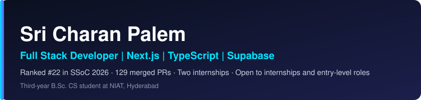
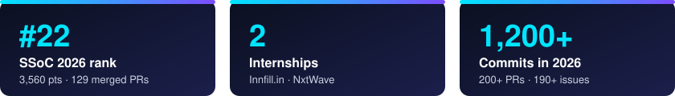
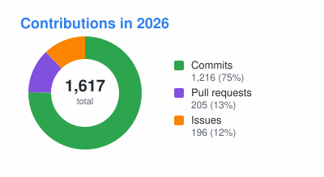
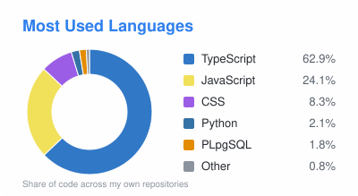
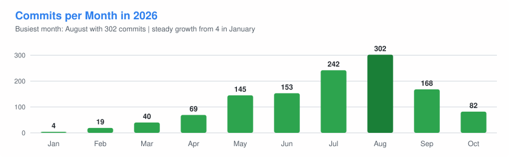

---

---

| Role | What I did |
|---|---|
| **Software Engineer Intern**, Innfill.in Sep 2026 to present, hybrid | Build frontend features, backend services and REST APIs on Zoho Catalyst for Innfill and its client companies. Integrate Zoho CRM, Mail, ZeptoMail, Vault and Cliq for business workflows, email automation and security. |
| **Full Stack Developer Intern**, NxtWave May 2026 to Aug 2026, remote | Built and deployed 4+ production websites with Next.js (App Router, SSR/SSG) and Supabase (PostgreSQL, Auth, Row-Level Security). Owned technical SEO: segmented sitemaps, sitemap index and robots.txt. Automated daily blog publishing with cron jobs. |
| **Open Source Contributor**, SSoC 2026 Jun 2026 to Jul 2026 | Ranked #22 overall. Merged 129 pull requests across multiple repositories by scoping issues, shipping fixes and features, and iterating on maintainer review. |

---

| Project | What it does | Stack |
|---|---|---|
| [**CollegeInsiders**](https://collegeinsiders.in) | Live platform connecting college aspirants with student mentors. I built Google login, role-based access control and pie/bar chart analytics dashboards for the admin portal, and improved search discoverability and page-load speed. | Next.js, TypeScript, Supabase, Technical SEO |
| **airPe** (client project) | Credit card rent payments. I integrated Elavon card payments (tokenization, recurring billing), landlord payouts by Interac e-Transfer and EFT, payment status tracking, settlement workflows, recurring-payment cron jobs and ZeptoMail emails. Source is private. | React, TypeScript, Node.js, Express, Zoho Catalyst, PropelAuth, Elavon |
| [**GenZ Store**](https://github.com/sricharan12-hub/genzstore) | Full-stack fashion e-commerce storefront and backend with Razorpay payments (UPI, cards, net banking), COD, and OAuth plus email login. | Next.js, TypeScript, Tailwind, Node.js, Express, MongoDB, Redis |
| [**AI Gmail Automation**](https://github.com/sricharan12-hub/Gmail-Automation) | Event-driven n8n pipeline that classifies inbound email in real time with OpenAI and routes it through Gmail and Slack, with retry and error-handling logic for unattended runs. | n8n, OpenAI, Gmail API, Slack API |
| [**AI Inbox Cleaner**](https://github.com/sricharan12-hub/n8n-project) | Automated inbox hygiene: AI detects and deletes transaction emails, plus scheduled Spam and Bin cleanup. | n8n, Gemini, Gmail API |
| [**Chat Application**](https://github.com/sricharan12-hub/Chat-application) | Real-time chat with authentication and message history. | MERN, real-time messaging |
| [**Algo-Infinity-Verse**](https://github.com/sricharan12-hub/Algo-Infinity-Verse) | Open-source platform with 200+ algorithm visualizers for DSA, system design and CS fundamentals. My fork; I contribute through SSoC 2026. | JavaScript, Docker |

---

**Frontend**
      

**Backend**
   

**Databases**
   

**Cloud and DevOps**
    

**Automation and AI**
  

**Languages and Tools**
    

**CS fundamentals:** Data Structures and Algorithms, Operating Systems, DBMS, Networking, OOP, System Design, REST APIs, JWT and OAuth, Technical SEO

---

<table align="center">
  <tr>
    <td align="center" valign="top" width="420"></td>
    <td align="center" valign="top" width="420"></td>
  </tr>
  <tr>
    <td align="center" valign="top" width="420"></td>
    <td align="center" valign="top" width="420"></td>
  </tr>
</table>

---

**Open to internships and entry-level roles.** Reach me at [sricharanpalem07@gmail.com](mailto:sricharanpalem07@gmail.com).
